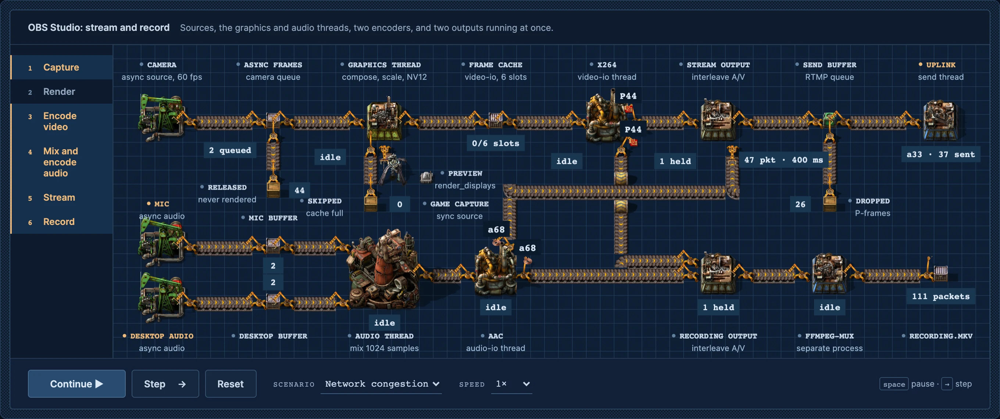

<h1 align="center">Factory</h1>

<p align="center"><b>A Claude skill that explains a program by building it as a working Factorio factory.</b><br>Also runs in Codex and OpenCode.<br>Values ride belts, inserters hand them over, machines do the work, and chests hold the state.</p>

<p align="center">
  <a href="https://code.claude.com/docs/en/skills"></a>
  <a href="https://agentskills.io"></a>
  <a href="LICENSE"></a>
  <a href="#requirements"></a>
  <a href="#requirements"></a>
  <a href="#game-assets"></a>
</p>

<p align="center">
  <a href="#quick-start">Quick start</a> ·
  <a href="#game-assets">Game assets</a> ·
  <a href="#what-it-makes">What it makes</a> ·
  <a href="#install">Install</a> ·
  <a href="#usage">Usage</a> ·
  <a href="#examples">Examples</a> ·
  <a href="#how-it-works">How it works</a> ·
  <a href="#limits">Limits</a>
</p>

<p align="center">
  
</p>

<p align="center"><sub><code>examples/obs-pipeline</code> under network congestion, 37 seconds in. The send buffer has backed up to 400 ms, and the stream has dropped 26 P-frames while the recording keeps every packet.</sub></p>

---

Ask Claude to explain a program, an algorithm or a whole system, and Factory has it build that program as a factory floor. Each value is an item on a belt. Each operation is a machine cycle. Stored state is stock in a chest. A filter is an assembler that lets some items through, a queue is a chest that keeps its order, and a cache miss is a machine that waits for a delivery.

The factory runs from a small, pure model of the program, so every count and readout on the floor is computed, not drawn. You can pause it, step it event by event, reset it, and change its input. For a real system, Claude first writes an inventory of its threads, queues and data paths from the code, so the figure keeps the system's real scope.

## Quick start

You need the [Vite+](https://viteplus.dev/guide/) CLI, `vp`, Node.js 24, and your own copy of Factorio 2.0 with Space Age.

```sh
git clone https://github.com/echohack/factory.git ~/.claude/skills/factory
cd ~/.claude/skills/factory
vp install
```

Export the game's data and icons once, as described in [Game assets](#game-assets), then import the art and open the examples:

```sh
vp run assets
vp run examples
vp preview
```

Open `http://127.0.0.1:4173/array-pipeline/` in your browser. Then, in Claude Code:

```text
/factory explain how an LRU cache with 4 slots evicts entries
```

In Codex, type `$factory`. `vp install` installs Vite+ itself, with Bun; the kit and scripts use only Node's built-in modules.

## Game assets

Factory draws with Factorio's own sprites. That art belongs to Wube Software, so this repository ships none of it. It publishes the list instead: [`assets/manifest.json`](assets/manifest.json) names all 330 files the library uses, each with its path in the game (`source`), its SHA-256 and its size. If you own the game, one command copies those files from your install into `assets/`, where Git ignores them.

1. **Turn off other mods.** In Factorio's **Mods** menu, leave only Base, Elevated Rails, Quality and Space Age on.
2. **Export the data and the icons.** Start the game twice, once with each option. Each run writes into the `script-output` folder and quits.
   - **Steam:** in your Library, right-click Factorio and open **Properties → General → Launch options**. Enter `--dump-data` and press **Play**. When the game has closed, enter `--dump-icon-sprites` and press **Play** again. Then clear the launch options.
   - **Standalone:** run the game binary with each option, for example on macOS:

     ```sh
     /Applications/factorio.app/Contents/MacOS/factorio --dump-data
     /Applications/factorio.app/Contents/MacOS/factorio --dump-icon-sprites
     ```

     On Windows the binary is `bin\x64\factorio.exe` in the install folder; on Linux it is `bin/x64/factorio`.
3. **Import.** From this repository, run `vp run assets`. It should print `Mapped 68 world objects and 28 item tokens; 330 source images.`

`vp run assets` looks for the game and its exports in these places:

| | Game data | Exports |
|---|---|---|
| **Windows**, Steam | `C:\Program Files (x86)\Steam\steamapps\common\Factorio\data` | `%APPDATA%\Factorio\script-output` |
| **Windows**, standalone | `C:\Program Files\Factorio\data` | `%APPDATA%\Factorio\script-output` |
| **macOS**, Steam | `~/Library/Application Support/Steam/steamapps/common/Factorio/factorio.app/Contents/data` | `~/Library/Application Support/factorio/script-output` |
| **macOS**, standalone | `/Applications/factorio.app/Contents/data` | `~/Library/Application Support/factorio/script-output` |
| **Linux**, Steam | `~/.steam/steam/steamapps/common/Factorio/data` | `~/.factorio/script-output` |
| **Linux**, standalone | `factorio/data`, where you unpacked it | `factorio/script-output` |

If your copy is somewhere else, name the folders:

```sh
vp run assets --data "/path/to/Factorio/data" --script-output "/path/to/script-output"
```

`FACTORIO_DATA` and `FACTORIO_SCRIPT_OUTPUT` do the same. The import copies each file byte for byte and checks every sprite's layout against its image. It does not change your game files.

The library was mapped on Factorio 2.0.77. A later 2.0 release can change some sprites: the import then rewrites `assets/manifest.json`, and `git diff` shows what changed. Without Space Age the import stops, because the OBS example and several library objects are Space Age machines.

Built pages in `dist/` contain the imported art too. Check Wube's terms before you publish one.

## What it makes

A figure is a local static site: one workbench page with the factory floor at the top, a narrow list of the program's phases beside it, one row of controls under it, and reference tables below.

| Part | What it shows |
|---|---|
| **The floor** | Native Factorio belts, inserters, assemblers, chests and circuits on the game's own tile plane, with station labels and live readouts. Items stay with their current owner: on a belt lane, in an inserter's closed hand, or in an inventory. |
| **Phases** | The program's phases, top to bottom. The active one lights up, and a click jumps to it. Independent work, such as two consumers of one table, runs in parallel lanes. |
| **Controls** | Play, step, reset, speed and the program's input. Keyboard controls stay inside the figure. |
| **Tables** | Each operation's inputs, rule and parameters, and a worked example, all computed from the model. |

Every figure fits a phone, starts paused under reduced motion, stops working while it is off screen, and announces completed events to screen readers.

## Install

Factory is a standard [Agent Skill](https://agentskills.io): a folder with a `SKILL.md` at its root. Clone this repository into a skill folder, then run the [import](#game-assets) inside it.

| | Command |
|---|---|
| **Claude Code**, for you | `git clone https://github.com/echohack/factory.git ~/.claude/skills/factory` |
| **Claude Code**, for one project | `git clone https://github.com/echohack/factory.git .claude/skills/factory` |
| **Codex** | `git clone https://github.com/echohack/factory.git ~/.agents/skills/factory` |
| **OpenCode** | `git clone https://github.com/echohack/factory.git ~/.config/opencode/skills/factory` |

To update, run `git pull` in that folder. The imported art stays, because Git ignores it.

Claude Code picks up new skills in a running session; start a new session if `/factory` does not show. In Codex, run it with `$factory`.

## Usage

Type `/factory` (in Codex, `$factory`) and say what the figure should explain:

```text
/factory explain how a token bucket rate limiter admits a burst of 12 requests with a bucket of 5
```

You don't have to name the skill. Claude also loads it when you ask for a Factorio-style explainer.

<details>
<summary><b>More prompts</b></summary>

<br>

```text
/factory how does this repository's job queue retry a failed job? Read src/queue and draw the real stages.
```

```text
/factory show a write-through cache in front of a slow database: 3 hits, 2 misses, and an eviction
```

```text
/factory explain how Git's three-way merge combines two branches that both changed one file
```

</details>

Three habits get the best figures:

1. **Point at the real code.** Factory reads it, writes an inventory of the parts, and draws all of them. A figure of a system shows every thread, queue and output, not one path through it.
2. **Give real numbers.** Sizes, counts, rates and limits. The model uses them, and the floor shows their effects.
3. **Say what should go wrong.** A miss, a rejection, a dropped frame or a full queue is shown by what the machines do, not only by a color.

## Examples

Build them with `vp run examples` and serve them with `vp preview`, after the [import](#game-assets).

| Example | What it shows | Page |
|---|---|---|
| [`array-pipeline`](examples/array-pipeline) | `[2, 5, 4, 7, 6, 3, 8, 1].filter(even).map(triple).reduce(sum, 0)` in JavaScript's eager order: all filtering, then all mapping, then the reduction. Chests hold each intermediate array, and the reduce chest ends at 60. Change the input and run it again. | `/array-pipeline/` |
| [`obs-pipeline`](examples/obs-pipeline) | OBS Studio streaming and recording at once: sources, the graphics and audio threads, two encoders and two outputs, each on its own clock. Load healthy, rendering lag, encoding lag or network congestion and watch where frames are dropped. | `/obs-pipeline/` |
| [`catalog`](examples/catalog) | The object library: 68 world objects and 28 item tokens, with search, category filters, directions, states and animation previews. | `/catalog/` |

Search the library from the terminal with `vp run objects cache`.

## How it works

- **[`SKILL.md`](SKILL.md)** is what Claude reads. It sets the workflow: read the program, write the architecture inventory, map program parts to factory parts, write a pure model, build the scene from the kit, and verify the result in a browser.
- **[`kit/`](kit)** is the framework-free browser kit: deterministic trace playback (`trace.mjs`), native sprite drawing (`sprites.mjs`), the tile scene with belts, labels and moving items (`scene.mjs`), inserter placement and poses (`transport.mjs`), the phase list (`process.mjs`) and grid-snapped tables (`tables.mjs`).
- **[`references/`](references)** are the long-form guides Claude opens when it needs them: program mapping, the kit API, the object library, game assets, inserters, design and verification.
- **The library.** [`catalog/objects.mjs`](catalog/objects.mjs) selects each object from the game's prototype definitions. `vp run assets` turns that into `assets/manifest.json` and `assets/catalog.json`, and copies the art.
- **Verification.** `vp test` runs the test suite on [Vite+](https://viteplus.dev). It checks the models, event conservation, stepping, sprite crops and asset path handling. With Playwright, `vp run verify-browser` and `vp run verify-catalog` drive the built pages at desktop and phone sizes and save screenshots.

<details>
<summary><b>Repository layout</b></summary>

<br>

```text
factory/
├── SKILL.md                  the skill: workflow, mapping rules and design
├── kit/                      the browser kit: trace, sprites, scene, transport, process, tables
├── references/               long-form guides Claude reads as needed
├── catalog/objects.mjs       the object library's selections and program roles
├── assets/
│   ├── manifest.json         every imported file: game path, SHA-256 and size
│   ├── catalog.json          objects, roles, footprints and variants
│   └── materials/            the workbench textures
├── examples/                 array-pipeline, obs-pipeline and the catalog browser
├── scripts/                  import, build and browser checks
├── tests/                    Vite+ test suites
├── vite.config.mjs           Vite+ tasks, preview and test settings
├── agents/openai.yaml        the skill's display name in Codex
└── .github/assets/           README images
```

</details>

## Requirements

| | Needed for | Notes |
|---|---|---|
| **Factorio 2.0 with Space Age** | the art | Your own copy, from Steam or factorio.com. The library was mapped on 2.0.77. |
| **[Vite+](https://viteplus.dev/guide/)** | every command | Install the `vp` CLI once, then run `vp install` in the repository; it installs with Bun 1.2.4. Without the global CLI, `bun install` and `bunx vp` work the same. |
| **Node.js 24** | everything | Pinned in `.nvmrc`; Vite+ also runs on 22.18 or later. The kit and scripts use only built-in modules. |
| **A browser** | viewing figures | Figures are multi-file static sites. `vp preview` serves them on `127.0.0.1:4173`. |
| **[Claude Code](https://code.claude.com/docs/en/overview)**, [Codex](https://developers.openai.com/codex/skills) or [OpenCode](https://opencode.ai/docs/skills/) | using the skill | Written for Claude Code; it follows the open Agent Skills format. |
| **Playwright and Chrome** | the browser checks only | Not installed by this repository. Point `PLAYWRIGHT_MODULE` at an existing installation; see [`references/verification.md`](references/verification.md). |

## Limits

- **It needs the game.** No art ships with the repository, and there is no fallback for the base game without Space Age.
- **The motion is illustrative.** Event durations are presentation time, and parallel lanes show independence, not measured timing. Inserter swings are choreography on measured joints, not the game's physics.
- **Not every in-game effect is drawn.** Stripes, runtime tints, lighting, smoke and working glows are unsupported, so some machine bodies are static. The catalog notes what each object omits. Electric mining drills, the electromagnetic plant, vehicles, rails and creatures are deferred.
- **It explains; it does not profile.** A figure built from an explicit model says so. Timing claims need a real trace.

## Contributing

Pull requests are welcome. Read [CONTRIBUTING.md](CONTRIBUTING.md) first: it covers the import, the tests, the browser checks, and the house rules a change has to keep (among them, no comments in code and no game art in Git). Report security problems as described in [SECURITY.md](SECURITY.md). Issues and the wiki are turned off.

- [Contributing guide](CONTRIBUTING.md)
- [Changelog](CHANGELOG.md)

## License

[Apache 2.0](LICENSE) © 2026 echohack

The license covers this repository's code and documentation. It does not cover Factorio or its art. Factorio is a trademark of Wube Software Ltd., and this project is not affiliated with or endorsed by Wube Software.
